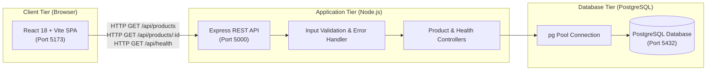

# GenZ Fits (VÉLORA Collection) — College E-Commerce Lab Assignment (Part 1)

> **Course:** MNIT Programming Lab  
> **Assignment:** Lab Assignment 9 — Full-Stack E-Commerce Product Catalog  
> **Brand & Theme:** GenZ Fits · VÉLORA Contemporary Atelier (Minimalist Tailoring, Streetwear & Architectural Silhouettes)  
> **Color Scheme:** Warm Ivory (`#faf8f5`), Pitch Black (`#111111`), Subtle Taupe (`#e6dfd5`), and Deep Burgundy (`#741221`)  
> **Currency:** Indian Rupee (INR — `₹`)

---

## 1. System Architecture

GenZ Fits strictly adheres to a clean **3-Tier Architecture**. The React frontend **never connects directly to PostgreSQL**; all data access is mediated through the Express REST API with input validation and centralized error handling.



---

## 2. Tech Stack

- **Frontend:** React 18, Vite, Vanilla CSS (custom design system with CSS custom properties), Lucide React (minimalist iconography).
- **Backend:** Node.js, Express 4.x, CORS, Dotenv.
- **Database:** PostgreSQL 14+, `pg` (node-postgres connection pool).
- **Design Philosophy:** Editorial luxury fashion layout, distinctive high-fashion typography (`Cormorant Garamond` serif display paired with `Plus Jakarta Sans` clean body), warm ivory canvas backgrounds, black typography, subtle taupe architectural borders, and deep burgundy accents.

---

## 3. Directory Structure

```text
e-commerce-lab/
├── .gitignore                      # Excludes node_modules, secrets (.env), and builds
├── package.json                    # Root orchestration scripts
├── README.md                       # Complete lab documentation
├── screenshots/                    # Submission screenshots directory
│   ├── 01-product-listing.png      # Product catalog grid with hero & categories
│   ├── 02-product-details.png      # Modal view with garment specifications & sizing
│   ├── 03-search-and-filter.png    # Live search & category filtering
│   ├── 04-empty-state.png          # Empty state with reset filters action
│   └── README.md                   # Screenshots documentation
├── database/                       # PostgreSQL SQL scripts
│   ├── schema.sql                  # Table DDL, constraints, and indexes
│   ├── seed.sql                    # 12 contemporary fashion products seed data
│   └── init-db.js                  # Standalone database forwarder runner
├── backend/                        # Node.js + Express REST API
│   ├── package.json
│   ├── .env.example                # Example environment variables
│   └── src/
│       ├── server.js               # Express application entry point (Port 5000)
│       ├── config/
│       │   ├── db.js               # pg Pool configuration & health checks
│       │   └── initDb.js           # Database migration & seed executor
│       ├── controllers/
│       │   └── productController.js# Query execution, filtering, sorting, health
│       ├── middleware/
│       │   ├── errorHandler.js     # 404 and global JSON error handlers
│       │   └── validator.js        # ID & query parameter validators
│       ├── routes/
│       │   ├── apiRoutes.js        # Main API router (/api/health, /api/products)
│       │   └── productRoutes.js    # Product routes
│       └── data/
│           └── initialProducts.js  # 12 seed fashion products dataset & fallback
└── frontend/                       # React + Vite application
    ├── package.json
    ├── vite.config.js              # Vite server & reverse-proxy configuration
    ├── index.html                  # HTML shell with Google Fonts & metadata
    ├── .env.example
    └── src/
        ├── index.css               # Design system & responsive styles
        ├── main.jsx                # React DOM mount point
        ├── App.jsx                 # Main stateful catalog orchestrator
        ├── services/
        │   └── api.js              # Fetch client for Express REST endpoints
        └── components/
            ├── Navbar.jsx          # Brand header & live connection status
            ├── HeroBanner.jsx      # 'Discover Your Style' hero & 'Explore Collection' CTA
            ├── SearchAndFilter.jsx # Live search, category pills & sort dropdown
            ├── ProductGrid.jsx     # Responsive product card layout
            ├── ProductCard.jsx     # Card with image zoom, tags, rating & INR price
            ├── ProductDetailModal.jsx # Deep details view, fabrication, sizing & SKU
            ├── StatusStates.jsx    # Shimmer skeleton, empty state, error state
            └── Footer.jsx          # Academic metadata & tech stack badges
```

---

## 4. Prerequisites

1. **Node.js** (v18.0.0 or higher recommended, verified on v24+)
2. **npm** (v9.0.0 or higher)
3. **PostgreSQL** (v14.0 or higher) — *Note: The backend contains an automatic, non-blocking fallback mechanism that serves the complete 12-item fashion seed dataset even if PostgreSQL is not currently running locally, allowing uninterrupted evaluation.*

---

## 5. PostgreSQL Database Setup

### Step A: Start PostgreSQL
- **Windows:** Start the PostgreSQL service via Services (`services.msc`) or PowerShell:
  ```powershell
  Start-Service postgresql*
  ```
- **macOS / Linux:**
  ```bash
  sudo systemctl start postgresql
  ```

### Step B: Create the Database
```bash
createdb -U postgres genz_fits
```

### Step C: Initialize Schema & Seed Data
Run the automated initialization runner:
```bash
npm run db:init
```
*(Or manually via psql: `psql -U postgres -d genz_fits -f database/schema.sql` and `psql -U postgres -d genz_fits -f database/seed.sql`)*

---

## 6. How to Run the Application

Open two separate terminal windows or use the root scripts:

### Terminal 1: Backend Server (Port 5000)
```bash
cd backend
npm install
npm run dev
```
*API is accessible at `http://localhost:5000`.*

### Terminal 2: Frontend Client (Port 5173)
```bash
cd frontend
npm install
npm run dev
```
*Web client is accessible at `http://localhost:5173`.*

---

## 7. REST API Documentation

### 7.1 Health Check
- **Endpoint:** `GET /api/health`
- **Response `200 OK`:**
  ```json
  {
    "success": true,
    "status": "ok",
    "service": "genz-fits-api",
    "collection": "VÉLORA Contemporary Fashion",
    "uptime": "128s",
    "timestamp": "2026-10-29T10:00:00.000Z",
    "database": {
      "type": "PostgreSQL",
      "configuredHost": "localhost",
      "connected": true,
      "statusMessage": "Connected to PostgreSQL database"
    }
  }
  ```

### 7.2 Get Products Catalog
- **Endpoint:** `GET /api/products`
- **Query Parameters:**
  | Parameter | Type | Default | Description |
  | :--- | :--- | :--- | :--- |
  | `category` | string | `all` | Filter by category: `Jackets & Outerwear`, `Shirts & Tops`, `Trousers & Bottoms`, `Dresses & Silhouettes`, `Sneakers & Footwear`, `Accessories & Leather` |
  | `search` | string | `""` | Search query matching garment name or description |
  | `sortBy` | string | `newest` | `newest`, `price_asc`, `price_desc`, `rating`, `name_asc`, `name_desc` |
- **Response `200 OK`:**
  ```json
  {
    "success": true,
    "count": 12,
    "data": [
      {
        "id": 1,
        "name": "Oversized Wool Trench Coat",
        "slug": "oversized-wool-trench-coat",
        "category": "Jackets & Outerwear",
        "description": "Double-breasted tailored trench coat woven from a heavyweight virgin wool blend...",
        "price": "6999.00",
        "stock": 18,
        "image_url": "https://images.unsplash.com/photo-1544022613-e87ca75a784a?auto=format&fit=crop&w=1000&q=80",
        "rating": "4.90",
        "reviews_count": 88,
        "material": "70% Virgin Wool, 30% Polyamide (Cupro Satin Lining)",
        "dimensions": "Sizes: XS, S, M, L, XL",
        "origin": "Vélora Atelier Milano",
        "in_stock": true
      }
    ]
  }
  ```

### 7.3 Get Single Product Details
- **Endpoint:** `GET /api/products/:id`
- **Route Parameters:** `id` (Positive Integer)
- **Response `200 OK`:** Single product JSON object.
- **Response `404 Not Found`:** `{ "success": false, "error": "Product not found with ID: 999" }`
- **Response `400 Bad Request`:** `{ "success": false, "error": "Invalid product ID. The ID must be a positive integer." }`

---

## 8. Frontend Features & Aesthetic Direction

1. **Brand Identity:** **GENZ FITS** featuring the **VÉLORA Collection** (contemporary atelier).
2. **Editorial Hero Section:** Features the bold headline *"Discover Your Style. Tailored for the new era."* and an interactive **"Explore Collection"** button that smoothly scrolls to the catalog.
3. **Color Palette:** Warm Ivory (`#faf8f5`), Pitch Black typography (`#111111`), Subtle Taupe structural lines (`#e6dfd5`), and Deep Burgundy accents (`#741221`).
4. **INR Currency Formatting:** All prices formatted consistently in Indian Rupees (`₹2,799`, `₹6,999`).
5. **Interactive Controls:**
   - 300ms debounced live search with one-click clear button.
   - Category filter pills for 6 distinct fashion categories.
   - Sort dropdown for pricing, ratings, and alphabetical order.
6. **Garment Detail View:** Technical specifications table displaying fabrication/materials, sizing and fit, atelier origin, and collection SKU (`GZF-XXXX`).
7. **Three-State UX:** Shimmer skeletons, empty state with filter reset, and API error retry banner.
